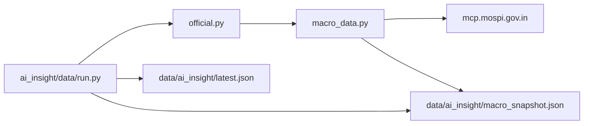

# MoSPI macro data (AI Insights)

**Status:** planned (not implemented)  
**Package:** [`ai_insight/data/`](../data/)  
**Upstream:** https://mcp.mospi.gov.in/ (JSON-RPC `tools/call`, no auth)

## Goal

Replace stub `fetch_mospi()` calls in [`official.py`](../data/official.py) with real CPI, WPI, IIP, and GDP fetchers. Add typed Pydantic `MacroSnapshot` for the news/sentiment pipeline, plus `NumericRecord` summaries for [`run.py`](../data/run.py) → `data/ai_insight/latest.json`.

## Verified availability (live probes)

| Entity | MoSPI dataset | Available now | Latest seen |
|--------|---------------|---------------|-------------|
| CPI | CPI | Yes | base 2024, Apr 2026 (`index`, `inflation` YoY) |
| WPI | WPI | Yes | base `2022-23`, Sep 2026 (`index_value`; YoY derived) |
| IIP | IIP | Yes | base `2011-12`; `index`, `growth_rate`; latest month TBD via walk-back |
| GDP | NAS (ind 5) | Yes | FY 2025-26 Q1–Q4 (`current_price` / `constant_price` Rs crore) |
| Bond yields | RBI | **No** | RBI set has trade/BoP/FX/debt only — no G-sec yields |
| GST | — | Manual | User adds monthly; keep existing PIB stub / manual path |

**Bond yields:** keep [`fetch_gsec()`](../data/official.py) (RBI HTML best-effort) until a JSON source (e.g. FRED) is wired. MoSPI cannot supply yields.

## API contract (always in order)

1. `list_datasets`
2. `get_indicators(dataset)`
3. `get_metadata(dataset, …)` — build filters **only** from this response
4. `get_data(dataset, filters={…})` — `level` is **not** a `get_data` filter for CPI; `series` is required

Implementation uses **httpx** + SSE parse (`data: {json}`), not an MCP client in FastAPI.

## Files to add / change

| Path | Action |
|------|--------|
| [`ai_insight/data/macro_data.py`](../data/macro_data.py) | **New** — `MospiClient`, retries, 24h file cache under `data/ai_insight/cache/mospi/`, Pydantic models, `fetch_cpi/wpi/iip/gdp`, `get_macro_snapshot()`, bond stub |
| [`ai_insight/data/official.py`](../data/official.py) | **Edit** — call macro_data for CPI/WPI/IIP/GDP instead of `fetch_mospi` stubs; map headline → `NumericRecord` (entity names unchanged) |
| [`ai_insight/data/run.py`](../data/run.py) | **Optional** — write `data/ai_insight/macro_snapshot.json` alongside `latest.json` |
| [`tests/test_ai_insight_mospi.py`](../../tests/test_ai_insight_mospi.py) | **New** — mocked httpx, cache TTL, YoY derivation, snapshot isolation |
| This plan | [`ai_insight/plans/mospi_macro_data.md`](mospi_macro_data.md) |

No `.cursor/mcp.json` required (direct HTTP).

## Design

- **Cache:** 24h TTL (metadata + `get_data`), same idea as [`news_rag/macro_news_cache.py`](../../news_rag/macro_news_cache.py); keys = tool + args hash.
- **Retries:** 3× backoff on timeout/5xx; surface 4xx `hint` without retry.
- **Models:** `CPIRecord`, `WPIRecord`, `IIPRecord`, `GDPRecord`, `BondYieldResult`, `MacroSnapshot` (`as_of`, `unavailable[]`, per-entity lists).
- **Scope:** CPI All-India combined + rural/urban headline; WPI major groups; IIP General + Sectoral (Mining/Mfg/Electricity); NAS GDP + GVA (indicators 5, 1).
- **YoY:** WPI and GDP computed from prior period; labelled derived in model metadata.

## Entities not in this ingest (gap list)

- Bond yields via MoSPI (unavailable)
- GST (manual monthly)
- Repo rate, PMI, core sector, fiscal deficit (out of scope unless requested)

## Risks

- CPI base-2024 filters and IIP latest month need metadata-driven walk-back at implementation time.
- MoSPI rate limits unknown.
- WPI/GDP YoY is computed, not official field.

## Implementation todos

1. `MospiClient` in `ai_insight/data/macro_data.py`
2. Pydantic models + `get_macro_snapshot()`
3. Fetchers + YoY derivation
4. Wire `official.py` → `NumericRecord`
5. Tests + `graphify update .`