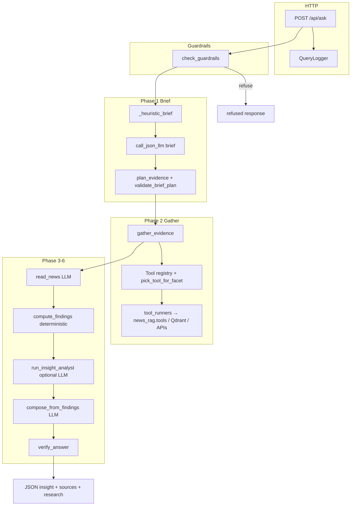
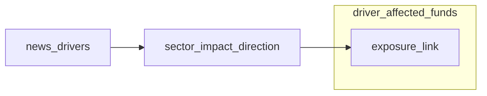

# Ask a Question — feature architecture (insight v2)

This document describes how the **Ask a Question** feature works in this repository as of the **insight v2** pipeline. The HTTP UI posts to `/api/ask`; the implementation lives under `news_rag/` and reads news from **Qdrant Cloud** plus on-disk fund/sector aggregates and live NAV/stock APIs where needed.

**Entry points**

| Layer | File | Role |
|--------|------|------|
| HTTP | `news_rag/app.py` | `POST /api/ask`, optional filters (`date_from`, `date_to`, `min_impact`, `source`, `direction`) |
| Engine | `news_rag/ask_engine.py` | Thin wrapper → `run_insight_pipeline` |
| Orchestration | `news_rag/insight/pipeline.py` | brief → gather → news_reader → compute → analyst → interpret → verify |
| Logging | `news_rag/query_log.py` | One file per ask under `data/rag_query_logs/ask_*.log` |

There is **no v1 ask agent** in the default path; `ASK_PIPELINE_V2` is kept for scripts but the engine always runs v2.

---

## End-to-end flow

**Typical latency:** first request on a cold server may load the embedding model (see `/health` → `embeddings_ready`). A full question with LLM brief, gather (500+ tool calls are rare; usually tens), news reader, and composer often runs **1–3 minutes** on a small VM.

---

## Phase 0: Guardrails and request context

**File:** `news_rag/guardrails.py` (called from `pipeline.run_until_compose`).

Out-of-domain or policy violations return early with `refused: true` and no gather.

**Gather context** (`GatherContext` in `news_rag/insight/gather.py`) carries:

- User question and optional API filters (`date_from`, `date_to`, `min_impact`, `source`, `direction`).
- `QuestionBrief` from phase 1.
- `fan_out_cap` from `INSIGHT_FAN_OUT_CAP` (default 8): max funds for per-fund tools.

**Base tool context** (`_base_ctx`) is a dict passed to every tool adapter:

| Key | Source |
|-----|--------|
| `question`, `sector_name`, `sector_keys`, `drivers`, `driver_direction` | Brief |
| `fund_names`, `stock_name` | Brief |
| `semantic_query` | sector, driver text, commodity hint, or question snippet |
| `window_days`, `return_window` | Brief |
| `date_from`, `date_to`, `min_impact`, `source`, `direction` | API + brief |
| `top_n` | fan_out_cap |
| `_articles`, `_funds`, `_composition`, `_sector_picks` | Filled during gather |

---

## Phase 1: Question brief

**File:** `news_rag/insight/brief.py`

The brief answers: *what did the user ask, which entities matter, which evidence facets are required, and how will we judge success?*

### Two planners (union, not either-or)

1. **Deterministic heuristic** (`_heuristic_brief` + `plan_evidence`) — always runs; extracts sectors, macro drivers, fund names, stocks, window, sub-asks, intent.
2. **LLM planner** (`call_json_llm`, stage `brief`) — adds sub-asks, entities, and `evidence_needs` the rules might miss.

Final `evidence_needs` = **validated union** of LLM facets + `plan_evidence` + `validate_brief_plan` (playbooks and dependency closure). A weak LLM reply cannot drop required facets.

### Entity detection (heuristic highlights)

- **Sector:** phrase matching against aggregated sector index (`_detect_sector`); weak-sector questions may pick worst-return sector (`worst_sector_by_return`).
- **Macro drivers:** keyword → driver ids (`_detect_drivers`), optional `driver_direction` (hike/cut/up/down).
- **Funds:** catalogue lookup (`fund_search`), compare patterns, random-N fund sampling for eval-style questions.
- **Stocks:** when share-price wording is detected.
- **Window:** regex on “6 months”, “1 year”, “last week”, etc. (default **180 days**).

### Sub-asks

Split on `?`, “and then”, “also”, etc. Kinds from `SUB_ASK_KINDS`: `describe`, `measure`, `compare`, `explain_cause`, `predict`, `list`.

### Deterministic `plan_evidence` rules (summary)

| Condition | Facets added |
|-----------|----------------|
| Sector in brief | `news_drivers`, `entity_state_over_time`, `benchmark` |
| Macro driver, no sector | `macro_driver_map`, `news_drivers` |
| Sector or driver + fund impact wording | `exposure_link`, `fund_composition`, `return_series`; driver-only also inserts `sector_impact_direction` before `exposure_link` |
| Named fund(s) | `fund_facts_nav`, `fund_composition`, `return_series`; optional `peer_compare`, `news_drivers` |
| Named stock | `stock_price`, `holding_drivers`; optional `stock_holders` |
| Gold/silver | `commodity_spot`, `news_drivers` |
| Market-wide wording, no entity | `market_overview` |
| Screen wording (category/AMC) | `fund_screen` |
| Sector list / help-hurt sectors | `news_drivers`, `sector_impact_direction` |
| Fallback | `market_overview` or `fund_facts_nav` |

`validate_brief_plan` then enforces **playbooks** (e.g. named fund → always add composition, returns, news, holding_drivers; strip sector-ranking facets when user named a single scheme) and **dependency closure** (e.g. `sector_impact_direction` requires `news_drivers` first).

### LLM brief schema

JSON fields include `goal`, `intent`, `sub_asks`, `subjects`, `evidence_needs`, `success_criteria`, plus entity fields mirrored from heuristics. System prompt includes `registry_prompt_block()` so the model sees **facets and tool catalog text** but is instructed to output **facet ids only**, not tool names.

---

## Evidence facets (vocabulary)

**File:** `news_rag/insight/facets.py`

All facet ids must be in `EVIDENCE_FACETS`. Aliases: `fund_facts_holdings` → `fund_composition`; `fund_facts_nav` can alias to `return_series` for validation.

| Facet | Meaning |
|-------|---------|
| `entity_state_over_time` | Sector/theme narrative over the window from news |
| `news_drivers` | Article-level drivers, tone, impact (quotable news) |
| `benchmark` | Sector index (or Nifty proxy) return over window |
| `forward_view` | Forward-looking themes from news layers |
| `market_overview` | Market-wide pulse / macro themes |
| `exposure_link` | Funds linked to sector or affected-sector picks (rankings) |
| `fund_composition` | Sector weights + top holdings for a fund |
| `return_series` | NAV return + series for a fund |
| `fund_facts_nav` | Latest NAV, standard return windows |
| `fund_facts_holdings` | Same data path as composition (alias) |
| `peer_rank` | Funds ranked by sector exposure |
| `fund_screen` | Catalog screen (category, AMC, stock, performance) |
| `sector_impact_direction` | Which sectors news helps vs hurts (LLM + rules) |
| `relationship_trace` | Direct vs indirect exposure to driver/sector |
| `macro_driver_map` | Rule table: driver → expected sector winners/losers |
| `fund_vs_index` | Fund holdings returns vs sector index |
| `holding_drivers` | News explaining a stock move |
| `stock_holders` | Funds holding a stock |
| `peer_compare` | Side-by-side named funds |
| `commodity_spot` | Gold/silver spot |
| `stock_price` | Stock price snapshot |
| `sector_holdings` | Representative companies in a sector |

---

## Phase 2: Gather — tools, registry, and dispatch

**Files:** `news_rag/insight/gather.py`, `news_rag/insight/registry.py`, `news_rag/insight/tool_runners.py`

### Mental model

- The **brief** lists **facets** (`evidence_needs`).
- **Gather** maps each facet → **one tool** via `pick_tool_for_facet` and `FACET_TOOL_PREFERENCE`.
- Tools declare **`provides`** facets, optional **`requires`** facets (dependencies), **`applies(ctx)`** gates, **`fan_out_over="fund"`**, and **`fallbacks`**.

The planner **never** names tools; only facets.

### Dependency closure

Before the round loop, `_close_dependencies` walks `requires` on chosen tools and adds missing facets to the ledger as `implied=True` (e.g. `driver_affected_funds` → needs `sector_impact_direction` → needs `news_drivers`).

Note: `exposure_link` for **sector** questions uses `sector_funds` directly; for **driver** questions preference order picks `driver_affected_funds` when `applies` (driver, no sector).

### Gather loop (per round)

1. Pending facets: ledger status `missing` or `partial`.
2. For each facet, `pick_tool_for_facet(facet, ctx, exclude=tried[facet])`.
3. If tool has `requires`, wait until those facets are `satisfied` (else skip this round).
4. If `fan_out_over=="fund"`, enqueue one job per fund in **shortlist** (cap `fan_out_cap` or tool’s `fan_out_cap`).
5. Deduplicate jobs `(tool_name, isin)`; run uncached jobs in a **thread pool** (max 6 workers).
6. Merge articles into `evidence.articles`; update shortlist from `exposure_link` / `fund_screen` rankings (unless user **named** funds — shortlist not diluted).
7. On failure, try tool **`fallbacks`** then mark `partial` / retry another provider next round.
8. Minimum **5 rounds** (`MIN_ROUNDS`), upper bound `ASK_AGENT_MAX_ROUNDS` from settings.

### Facet → preferred tools

From `FACET_TOOL_PREFERENCE` in `registry.py` (first **eligible** tool wins):

| Facet | Preference order (first match with `applies(ctx)` true) |
|-------|-----------------------------------------------------------|
| `news_drivers` | `fund_portfolio_news`, `macro_news_enhanced`, `layered_news`, `sector_news_signal`, `market_pulse` |
| `entity_state_over_time` | `layered_news`, `index_series`, `market_pulse` |
| `benchmark` | `index_series` |
| `exposure_link` | `driver_affected_funds`, `sector_funds`, `screen_funds` |
| `fund_screen` | `screen_funds` |
| `fund_composition` | `fund_composition` |
| `return_series` | `fund_return_series`, `fund_nav` |
| `fund_facts_nav` | `fund_nav` |
| `fund_facts_holdings` | `fund_composition` |
| `market_overview` | `market_pulse`, `layered_news` |
| `peer_rank` | `sector_funds`, `screen_funds` |
| `forward_view` | `layered_news`, `market_pulse` |
| `sector_impact_direction` | `affected_sectors` |
| `relationship_trace` | `trace_relationships` |
| `macro_driver_map` | `macro_sector_impact` |
| `fund_vs_index` | `sector_alignment` |
| `holding_drivers` | `fund_portfolio_news`, `holding_news` |
| `stock_holders` | `stock_holders` |
| `peer_compare` | `compare_funds` |
| `commodity_spot` | `metals_spot` |
| `stock_price` | `stock_snapshot` |
| `sector_holdings` | `sector_holdings` |

### Registered tools (insight registry)

Each row: **provides** | **requires** | **fan-out** | **applies gate** | **fallbacks** | **Implementation**

| Tool | Provides | Requires | Fan-out | Gate / notes | Fallbacks | Adapter → underlying |
|------|----------|----------|---------|--------------|-----------|---------------------|
| `layered_news` | `entity_state_over_time`, `news_drivers`, `forward_view` | — | — | Not “named fund only, no sector” | — | `run_layered_news` → Qdrant scoped retrieve |
| `macro_news_enhanced` | `news_drivers` | — | — | Driver present, **no** sector/fund subject | `layered_news` | `macro_news_enhanced.py` |
| `sector_news_signal` | `news_drivers` | — | — | Aggregate tone only | `layered_news` | wraps `layered_news` |
| `fund_portfolio_news` | `news_drivers`, `holding_drivers` | — | — | Named fund, no sector | `layered_news` | `run_fund_portfolio_news` |
| `holding_news` | `holding_drivers` | — | — | `stock_name` set | — | `holdings_market.fetch_dedicated_holding_news` |
| `market_pulse` | `market_overview`, `news_drivers` | — | — | Broad market questions | — | `market_pulse.py` |
| `sector_funds` | `exposure_link`, `peer_rank` | — | — | Sector / sector_keys | — | `run_sector_funds` |
| `driver_affected_funds` | `exposure_link` | `sector_impact_direction` | — | Driver, no sector | `sector_funds` | uses `_sector_picks` + `run_sector_funds` per sector |
| `screen_funds` | `fund_screen`, `exposure_link` | — | — | Not named-fund-only | — | `run_screen_funds` |
| `affected_sectors` | `sector_impact_direction` | `news_drivers` | — | Needs `_articles` in ctx | — | `pick_affected_sectors` + rule table |
| `fund_composition` | `fund_composition`, `fund_facts_holdings` | — | per fund | — | — | fund index detail |
| `fund_return_series` | `return_series` | — | per fund | — | `fund_nav` | `nav_service.fund_return_series` |
| `trace_relationships` | `relationship_trace` | — | per fund (cap 3) | — | — | `relationships.trace_relationships` |
| `sector_alignment` | `fund_vs_index` | — | per fund (cap 3) | — | — | `sector_alignment.run_sector_holding_alignment` |
| `index_series` | `benchmark` | — | — | — | — | `index_series.index_return_for_sector` |
| `macro_sector_impact` | `macro_driver_map` | — | — | `drivers` in ctx | — | `macro_impact_map` |
| `fund_nav` | `fund_facts_nav`, `return_series` | — | — | `fund_names` | — | `run_fund_nav` |
| `compare_funds` | `peer_compare` | — | — | ≥2 fund names | — | `run_compare_funds` |
| `stock_holders` | `stock_holders` | — | — | `stock_name` | — | `funds_holding_stock` |
| `stock_snapshot` | `stock_price` | — | — | `stock_name` | — | `run_stock_snapshot` |
| `sector_holdings` | `sector_holdings` | — | — | `sector_name` | — | `run_sector_holdings_tool` |
| `metals_spot` | `commodity_spot` | — | — | — | — | `run_metals_spot` |

### Sub-tool / internal call graph (important chains)

Tools are not nested as separate registry entries, but **adapters call other modules**:

| Parent tool | Calls (sub-steps) |
|-------------|-------------------|
| `layered_news` | `news_rag.tools.run_layered_news` → embed query → **Qdrant** filtered scroll/query → article bodies |
| `fund_portfolio_news` | Holdings/sectors from fund detail → layered news per layer |
| `sector_news_signal` | `layered_news` then aggregate counts |
| `affected_sectors` | `_articles` from gather → `pick_affected_sectors` (LLM) + `_rule_sector_picks` from `macro_impact_map` |
| `driver_affected_funds` | `_sector_picks` from `affected_sectors` → multiple `run_sector_funds` with weight floors |
| `sector_funds` | `sector_fund_ranking` index + holdings aggregate CSVs |
| `trace_relationships` | Needs `fund_composition` in `_composition[isin]` + `_articles` |
| `sector_alignment` | Fund holdings + sector index returns (yfinance) |
| `fund_nav` / `fund_return_series` | RupeeStop / NAV cache APIs |
| `compare_funds` | Multiple fund details + `run_compare_funds` blocks |

**Context prerequisites (runtime, not `requires` facet):**

- `affected_sectors`: `ctx["_articles"]` non-empty (gather runs `news_drivers` first).
- `driver_affected_funds`: `ctx["_sector_picks"]` after `sector_impact_direction` satisfied.
- Per-fund tools: `ctx["_funds"]` shortlist from named funds and/or `sector_funds` / `driver_affected_funds` / `screen_funds`.

### Post-gather enrichment

**`enrich_named_fund_why`** (`news_rag/insight/fund_why.py`): extra evidence for “why did this named fund move” patterns.

**Repair pass** (`pipeline.run_until_compose`): if brief names funds but `compute_findings` has no matching ISINs, re-run `fund_composition`, `fund_return_series`, `fund_nav` and recompute.

---

## Phase 3: News reader

**File:** `news_rag/insight/news_reader.py`

Optional LLM (`INSIGHT_USE_LLM_NEWS_READER`) reads cleaned article bodies from `evidence.articles` and produces structured claims, sector tone, sectors positive/negative (stage `news_reader` in query log).

If disabled or failing, compute falls back to digest/heuristic tone from articles.

---

## Phase 4: Compute findings

**File:** `news_rag/insight/blocks/compute.py`

**Deterministic** — no LLM. Builds `Findings`:

- **SectorFinding:** news direction, claims, index return from `benchmark` evidence.
- **FundFinding:** per shortlisted fund — sector weights, exposure to news-touched sectors, return vs window, alignment labels (`MIN_NEWS_EXPOSURE`, `DILUTED_BELOW`, `FLAT_RETURN` thresholds).

Uses evidence by facet (`exposure_link`, `fund_composition`, `return_series`, etc.) and `NewsRead` output.

---

## Phase 5: Analyst (optional)

**File:** `news_rag/insight/analyst.py`

When `INSIGHT_USE_LLM_ANALYST` is on, produces `analysis_brief` (net takeaways) fed into the composer.

---

## Phase 6: Interpret (compose)

**File:** `news_rag/insight/interpret.py`

LLM stage `interpret` builds headline, sector read, fund lines, closing summary from **findings only** (grounding rules in prompts). Streaming variant uses `stream_insight_pipeline` for SSE.

---

## Phase 7: Verify

**File:** `news_rag/insight/verify.py`

Checks answer against brief success criteria and evidence coverage; may record `verify_gaps` and `retry_facets` (retry loop is limited in practice).

**Judge LLM** (`output_judge.judge_answer`) is **disabled** in pipeline (telemetry skipped).

---

## Legacy tool layer (`news_rag/tools.py`)

Insight **adapters** call into this module for heavy lifting:

| Function | Used for |
|----------|----------|
| `run_layered_news` | Qdrant retrieval, filters, body fetch limits |
| `run_sector_funds` | Sector exposure rankings |
| `run_screen_funds` | Fund catalog filters |
| `run_fund_nav`, `run_compare_funds` | NAV and compare |
| `run_fund_portfolio_news` | Layered news for one fund |
| `run_sector_holdings_tool` | Sector constituents |
| `run_metals_spot`, `run_stock_snapshot` | Market data |

Retrieval uses `news_rag/scoped_retrieve.py` and embedding model under `data/embedding_models/`.

---

## API response shape (success)

Key fields from `pipeline.compose`:

- `insight`, `insight_summary`, `insight_bullets`, `sources` (from articles)
- `research`: `evidence_needs`, `ledger`, `findings`, `tool_runs`, `news_read`, `verify_gaps`
- `insight_source`: `insight_v2`
- Query log sidecar metadata attached via `attach_query_log_meta`

---

## Configuration (environment)

| Variable | Effect on ask |
|----------|----------------|
| `QDRANT_URL`, `QDRANT_API_KEY`, `QDRANT_COLLECTION` | News corpus |
| `RAG_LLM_PROVIDER`, `ANTHROPIC_*`, `GEMINI_*`, `DEEPSEEK_*` | Brief, news reader, interpret |
| `INSIGHT_FAN_OUT_CAP` | Max funds for fan-out tools |
| `INSIGHT_USE_LLM_INTERPRET`, `INSIGHT_USE_LLM_NEWS_READER`, `INSIGHT_USE_LLM_ANALYST` | Toggle LLM stages |
| `INSIGHT_LLM_ARTICLE_CHARS`, `INSIGHT_COMPOSER_MAX_ARTICLES` | Reader/composer limits |
| `ASK_AGENT_MAX_ROUNDS` | Gather round cap |

Fund data: committed under `data/fund_holdings_aggregate/`; NAV/holdings may call outbound RupeeStop APIs.

---

## Example facet plans

### “How is the banking sector doing over the last 6 months?”

Typical facets: `news_drivers`, `entity_state_over_time`, `benchmark`.

Tools: `layered_news`, `index_series`.

### “Crude oil fell — which mutual funds are negatively affected?”

Typical facets: `macro_driver_map`, `news_drivers`, `sector_impact_direction`, `exposure_link`, `fund_composition`, `return_series`.

Tool order: `macro_news_enhanced` or `layered_news` → `affected_sectors` → `driver_affected_funds` → per-fund composition/returns.

### “Why did HDFC Flexi Cap fall last month?”

Typical facets: `fund_facts_nav`, `fund_composition`, `return_series`, `news_drivers`, `holding_drivers`, `fund_vs_index` (via validate_brief_plan).

Tools: `fund_nav`, `fund_portfolio_news`, `fund_composition`, `sector_alignment`, etc.

### “What is happening in the market today?”

Typical facets: `market_overview` → `market_pulse` / `layered_news`.

---

## Debugging

1. Open latest `data/rag_query_logs/ask_*.log` for the question.
2. Search for `evidence_needs`, `GATHER`, `TOOL`, `ledger`, `interpret`.
3. In API JSON, inspect `research.ledger` and `research.tool_runs`.

---

## Related docs

- Shorter historical narrative: `news_rag/ask_a_question_architecture.md`
- Pipeline ingest (not ask): `docs/NEWS_PIPELINE_ARCHITECTURE.md`
- Deploy: `deploy/lightsail/DEPLOY.md`
