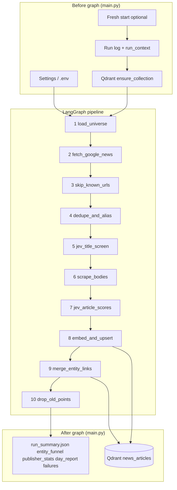
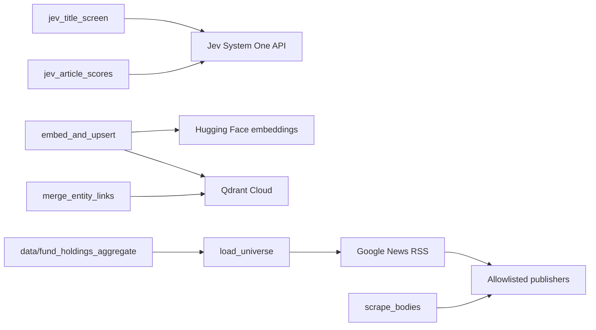

# News pipeline — architecture and data flow

This document describes how `python -m news_pipeline` (and each day inside `python -m news_pipeline.backfill_days`) moves data from universe definition to Qdrant, including **every filter layer**. The graph is a **single straight line** (no branches): see `news_pipeline/graph/build.py`.

Operational defaults and env vars: `news_pipeline/config.py`, `.env.example`, and the longer walkthrough in `docs/PIPELINE.md`.

---

## High-level diagram



---

## Data shapes between stages

| Stage | Primary state keys | Unit of work |
|--------|-------------------|--------------|
| After fetch | `candidates[]` | One row per **publisher URL** (plus `entity_name` on row) |
| After skip_known | `candidates[]`, `known_merges[]` | Unique URL; multiple **matches** (entity name/type) per URL |
| After dedupe | `candidates[]`, `canonical_merges[]` | Same; title-deduped **matches** per URL |
| After title Jev | `candidates[]` | URLs with **matches** + `title_relevance` (noul) |
| After scrape | `candidates[]` | + `scraped_text`, final `published_at` |
| After body Jev | `candidates[]` | **matches** + relevance/impact/direction/event scores |
| After upsert | `counts.upserted` | One Qdrant point per URL |

---

## Layer 0 — Bootstrap (`main.py`)

| Step | Purpose |
|------|---------|
| Load `Settings` | Holdings/sectors limits, date range, Jev, Qdrant, scrape backoff, corpus mode |
| Validate | `JEV_*`, `QDRANT_*`, `NEWS_DATE_RANGE` parse |
| Run context | `run_id`, `calendar_day`, `news_date_range` for artifacts |
| Fresh start | Optional wipe scrape cache / run JSON / Qdrant collection |
| Failure ledger | In-memory buffers + load `data/news_failures/*.json` |
| Logger | `data/news_runs/{subdir}/{run_id}.log` |
| Graph invoke | Linear pipeline |
| Artifacts | `{run_id}.json`, `run_summary.json`, `entity_funnel.json`, `publisher_stats.json`, `day_report.json`, failure slices |

**Backfill:** `backfill_days` sets `NEWS_DATE_RANGE` + `NEWS_RUN_SUBDIR=YYYY-MM-DD` per day and spawns `python -m news_pipeline` in a subprocess.

---

## Layer 1 — `load_universe`

**Input:** CSV aggregates (+ optional `PORTFOLIO_JSON`).

**Output:** `entities[]` — each has `name`, `type` (`holding` | `sector` | `macro`), `query`, `aliases`, `keywords`, `industry`, `fund_count`.

| Mode | Composition |
|------|-------------|
| Default | Top `holdings_limit` from `aggregated_holdings.csv` + top `sectors_limit` **mapped** sectors from `aggregated_sectors.csv` + all `MACRO_ENTITIES` if `macro_news_enabled` |
| Portfolio | `load_portfolio_universe` + macros |

**Filters (universe construction, not RSS):**

- Holdings: grouped by canonical name; ranked by `fund_count`.
- Sectors: row must match `SECTOR_QUERIES` in config; blocked sector name fragments skipped; capped by `sectors_limit` (~30 sectors have queries today).
- Macros: fixed list (e.g. Macro - Nifty 50, Macro - RBI Repo Rate).

**Funnel:** none (counts `entities` in run summary).

---

## Layer 2 — `fetch_google_news`

**Per entity** (parallel `fetch_workers`, default 1): one Google News RSS URL:

```text
https://news.google.com/rss/search?q={quote_plus(entity_query + " " + time_q)}&hl=en-IN&gl=IN&ceid=IN:en
```

`time_q` = `after:YYYY-MM-DD before:YYYY-MM-DD` when `NEWS_DATE_RANGE` is set, else `when:1d` (etc.).

**RSS row filters** (`news_pipeline/sources/google_news.py`):

| # | Filter | Drop bucket / effect |
|---|--------|----------------------|
| F1 | RSS fetch fails | Exception; `failed_google.json` kind `rss_fetch` |
| F2 | Missing link or title | `dropped_pre_resolve` |
| F3 | `is_english_title` — ≥80% Latin letters among alphabetic chars | `dropped_pre_resolve` |
| F4 | `article_in_fetch_window` — publish in `[start, end)` for date range; missing time **kept** at fetch | `dropped_pre_resolve` |
| F5 | `_match_publisher` — must be one of 10 `PUBLISHERS` domains (host or Google source label) | `dropped_publisher` |
| F6 | Google wrapper URL + `is_google_exhausted` in failure ledger | skip resolve; funnel `resolve_failed` |
| F7 | `cached_resolve` fails after up to `scrape_max_attempts` | funnel `resolve_failed`; `failed_google.json` kind `resolve` |
| F8 | Resolved URL not `https://` | `dropped_pre_resolve` |
| — | Pass | `google_kept`; `publisher_stats.record_received` |

**Other:** `google_breaker` (rate/block), global RSS throttle in `lib/fetch`, `max_items_per_query` (0 = unlimited kept per entity).

**Output:** Flat `candidates[]` (one list entry per entity×URL; merged later).

**Funnel per entity:** `rss_items`, `dropped_before_resolve`, `resolve_failed`, `google_kept`.

---

## Layer 3 — `skip_known_urls`

| Step | Behavior |
|------|----------|
| Merge | Same canonical URL → one row, `matches[]` for each entity |
| Qdrant lookup | If point id exists → `known_merges` (queued for `merge_entity_links`), not re-ingested |
| Fresh | Unknown URLs → continue as `candidates` |

**Funnel:** `skipped_existing` per entity on known URLs.

**Counts:** `merged_urls`, `skipped_existing`, `new_urls`.

---

## Layer 4 — `dedupe_and_alias`

**Per URL (newest first):**

| # | Filter | Effect |
|---|--------|--------|
| D1 | Corpus / run **story match** — fuzzy title vs Qdrant corpus (`corpus_title_dedupe_*` when `news_corpus_mode`) or in-run stories | Redirect to canonical URL → `canonical_merges` or absorb matches |
| D2 | **Per-entity title dedupe** — vs Qdrant `recent_titles` + titles seen this run | Drop individual **match**; if all matches dropped → drop URL |
| D3 | RapidFuzz `token_set_ratio` ≥ `title_similarity` (default 80); short titles (&lt;18 chars) exact match only | Duplicate title |

**Note:** Alias keyword gate is **off** (`alias_gate=off` in logs).

**Funnel:** `title_dedupe_dropped`, `after_title_dedupe`.

**Counts:** `after_title_dedupe`, `title_dedupe_dropped`, `canonical_story_merges`.

---

## Layer 5 — `jev_title_screen`

**Per entity:** batch Jev System One call with all titles linked to that entity.

| Step | Behavior |
|------|----------|
| Cap | `max_titles_per_jev_call` (0 = all) |
| Score | `read_noul` per title → stored as `title_relevance` |
| Logging | Pass/fail vs `title_noul_min` (default 0.5) in run log |
| Keep | URLs that still have at least one **match** with a score (pairs retained for scrape) |

**Funnel:** `after_title_jev`.

**Counts:** `after_title_jev` = unique URLs kept.

---

## Layer 6 — `scrape_bodies`

**Per URL** (parallel `scrape_workers`):

| # | Filter | `drop_reason` / notes |
|---|--------|---------------------|
| S0 | Failure ledger `is_source_exhausted` | `ledger_exhausted` (no HTTP) |
| S1 | `scrape_one` — fetch/resolve with backoff (`scrape_max_attempts`) | `fetch_failed`, `resolve_failed` (retriable) |
| S2 | `publish_time_for_scrape` — date range mode **trusts RSS**; else page date; outside window | `outside_news_window` (not retriable) |
| S3 | Empty title after scrape | `empty_title` |
| S4 | Thin body | Snippet/title fallback (not a drop) |

**Also:** `scrape_domain_gap_sec` wait per host; `publisher_stats` scraped / scrape_errors; `failure_ledger` source rows.

**Funnel:** `scrape_dropped` + `scrape_drop_reasons`, `scraped`.

**Counts:** `scraped`.

---

## Layer 7 — `jev_article_scores`

**Per scraped article:** one Jev call with truncated body (`body_words`).

| Step | Behavior |
|------|----------|
| Score | `about_this_name`, `relevance`, `impact`, `direction`, `event_type`, etc. per match |
| Body gates | `about_name_min` / `relevance_min` filters are **commented out** — all scored matches kept if Jev succeeds |
| Drop | Jev error on article → drop whole URL |

**Funnel:** `after_body_jev`.

**Counts:** `after_body_jev`.

---

## Layer 8 — `embed_and_upsert`

| Step | Behavior |
|------|----------|
| Build `StoredArticle` | Requires ≥1 entity in `matches` |
| Embed | `BAAI/bge-small-en-v1.5` on title + body snippet (`embed_chars`) |
| Upsert | One point per URL to Qdrant |
| Ledger | `mark_source_resolved` for successful URL |

**Funnel:** `upserted` per entity.

**Counts:** `upserted`, `scrape_files_removed`.

---

## Layer 9 — `merge_entity_links`

**No URL filtering** — updates existing Qdrant points:

- `known_merges` from skip_known (new entity tags on existing article).
- `canonical_merges` from dedupe (alias URL → canonical story).

May call Jev again to score new entity links.

**Counts:** `entity_links_merged`.

---

## Layer 10 — `drop_old_points`

| Condition | Behavior |
|-----------|----------|
| `news_corpus_mode` **or** `retention_days <= 0` | **No deletes** (backfill / corpus) |
| Else | Delete points older than `retention_days` (daily job default 30) |

**Counts:** `deleted`.

---

## External systems



---

## Observability map

| Artifact | What it captures |
|----------|------------------|
| `{run_id}.log` / `run.log` | Step timings, per-URL scrape, Jev verdicts, filter lines |
| `{run_id}.json` / `run_summary.json` | `counts`, `errors`, `error_summary`, `telemetry`, `qdrant` |
| `entity_funnel.json` | Per-entity stage counters (sums can exceed unique URLs) |
| `publisher_stats.json` | Per-domain `received` / `scraped` / `scrape_errors` |
| `day_report.json` | Pipeline counts + publisher totals + failure kinds |
| `failed_google.json` / `failed_source.json` | Day slice of failure ledger |
| `data/news_failures/google.json` | Rolling Google resolve/RSS failures |
| `data/news_failures/source.json` | Rolling publisher scrape failures |

---

## Typical count funnel (labels in run summary)

```text
entities
  → google_items          (sum of per-entity kept URLs; many URLs repeat across entities)
  → merged_urls           (unique URLs)
  → skipped_existing
  → new_urls
  → after_title_dedupe
  → after_title_jev
  → scraped
  → after_body_jev
  → upserted
  → entity_links_merged   (side path on known URLs)
  → deleted               (retention only)
```

---

## Entry points

| Command | Use |
|---------|-----|
| `python -m news_pipeline` | Single run (daily cron or manual) |
| `python -m news_pipeline.backfill_days` | Sequential days; subprocess per day |
| GitHub Actions | `daily-news-pipeline.yml`, `historical-news-backfill.yml` |

---

## Related docs

- `docs/PIPELINE.md` — step-by-step thresholds (some defaults differ from backfill env; trust `config.py` + workflow env).
- `deploy/cloudflare/DEPLOY.md` — trigger backfill; pipeline still runs on GitHub or VM.
